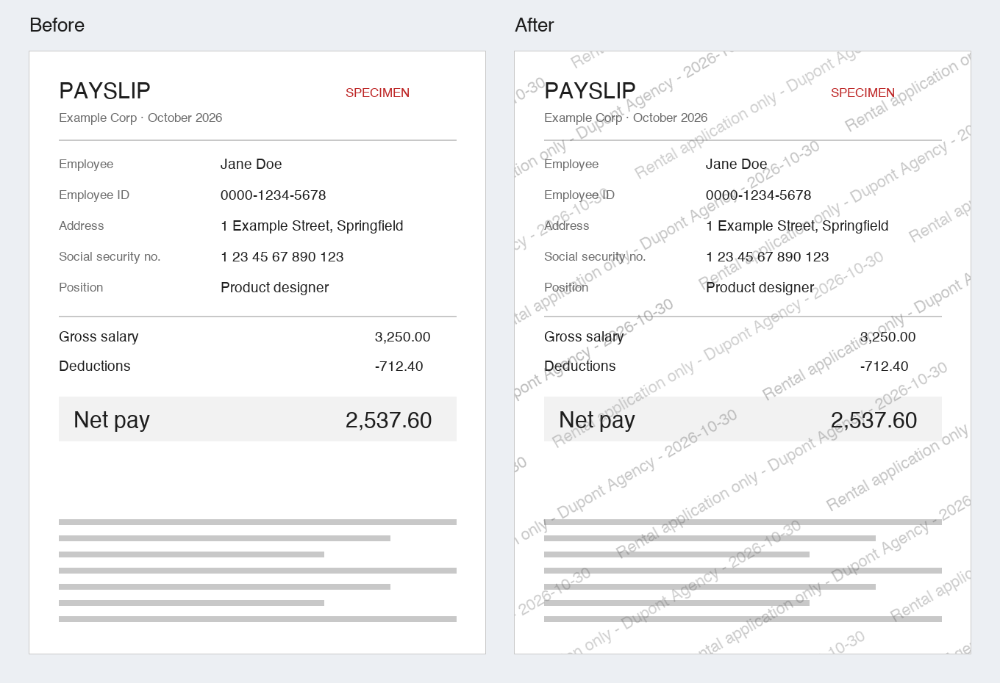

<p align="center">
  <picture>
    <source media="(prefers-color-scheme: dark)" srcset="docs/brand/logo-dark.svg">
    
  </picture>
</p>

<p align="center">
  <a href="https://github.com/thomascapelo/tilemark/actions/workflows/ci.yml"></a>
  <a href="LICENSE"></a>
  
</p>

<p align="center">
  Burn a watermark into your PDFs and images that is hard to remove, keeps every word readable<br>
  and traces each copy back to its recipient. Use it before sending your ID card, payslips or
  tax notices to a landlord, an agency or a bank.
</p>



## Why

Rental and loan applications routinely ask for copies of identity documents.
Once sent, those copies can be reused for identity fraud. Writing the recipient
and the purpose across every page ("Rental application only - Dupont Agency -
2026-10-30") makes a leaked copy useless for anything else.

## Private by design

- **Runs entirely on your computer.** No upload, no network access, no telemetry.
- **The watermark is part of the pixels.** PDF pages are rasterized and rebuilt
  as images: there is no layer to delete in a PDF editor and no selectable text
  left underneath.
- **No retouching shortcut.** Each copy of the text has a thin outline that
  is as dark as your document's own text on blank paper, and light over photos
  and dark areas. No brightness, contrast, "levels" or color-channel
  adjustment can separate the watermark from the document: removing it means
  either keeping visible traces or erasing the text too. A test in the suite
  runs that attack at every threshold to keep it that way.
- **Your document stays readable.** The outline passes behind printed text
  instead of cutting through it, so the recipient can still read every word
  and figure.
- **No predictable pattern.** Angle, tiling offset, a wave distortion and
  per-copy strength are randomized for every file, so the overlay cannot simply
  be rebuilt and subtracted.
- **QR codes and 2D-Doc stay scannable.** Codes found on a page are left
  untouched, so a landlord can still check that your tax notice or payslip is
  genuine.
- **Every copy is traceable.** A short reference (`Ref 7KQ2`) is added to the
  text and logged with the date, recipient text and files in
  `~/.tilemark/history.csv`, on your computer only. If a copy leaks, you know
  who you sent it to.
- **Metadata is stripped**: PDF author and title, EXIF data including GPS
  location, ICC profiles, PNG text chunks.
- **Originals are never modified.** Results go to a `watermarked/` subfolder
  next to them.

No visible watermark is impossible to remove: AI inpainting tools can erase a
lot. The goal is to make removal slow and visible, and a leaked copy traceable.

## Install

Requires Python 3.10+ and [pipx](https://pipx.pypa.io/).

```bash
pipx install git+https://github.com/thomascapelo/tilemark
```

If `tilemark` is then "command not found", run `pipx ensurepath` once and open
a new terminal.

## Usage

```bash
tilemark ~/Documents/rental_application
```

To watermark only some files, give them instead of a folder:

```bash
tilemark ~/Documents/id_card.pdf ~/Documents/payslip.jpg
```

Or run `tilemark` alone and, when prompted, drag a folder or files into the
terminal, or type a path (Tab completes folders and supported files).
You are then asked for the watermark text; today's date and a reference are
appended.

```
 tilemark   v0.2.1 · local only, nothing leaves this machine

◇  Watermark text
│  Rental application only - Dupont Agency - 2026-10-30 - Ref 7KQ2
│
◇  Processing 3 files
│  ✓ id_card.pdf    2 pages
│  ✓ payslip.jpg
│  ▲ notes.txt      skipped · unsupported format
│
└  2 files watermarked in 0.8s
   ~/Documents/rental_application/watermarked
   Ref 7KQ2 · logged in ~/.tilemark/history.csv
```

| Option | Effect |
|---|---|
| `--opacity 0.4` | Watermark strength, from 0.05 to 1.0 (default 0.30) |
| `--no-date` | Do not append today's date |
| `--no-ref` | Do not add a reference nor log the run |
| `--version` | Show the version |

Supported formats: PDF, JPG/JPEG, PNG. For a folder, only files directly
inside it are processed, not subfolders, and hidden files are ignored. Files
given one by one must be in the same folder. Unsupported,
corrupted or password-protected files are reported and the rest are still
processed. A PDF that looks truncated is processed but flagged
"possibly incomplete: check it".

**Tip:** name both the recipient and the purpose in the text. "CONFIDENTIAL"
protects much less than "Rental application only - Dupont Agency".

## How it works

1. Each PDF page is rendered at 150 DPI with [PDFium](https://pdfium.googlesource.com/pdfium/)
   (via `pypdfium2`), including annotations and filled-in form fields.
2. QR codes and Data Matrix codes (2D-Doc) are located with
   [zxing-cpp](https://github.com/zxing-cpp/zxing-cpp) so they can be spared.
3. The text is tiled in staggered rows from a random offset, given a random
   wave, rotated by 30° ± 5°, then applied twice: a light gray fill for
   legibility and a thin outline in the inverse of the surrounding colors,
   which passes behind text printed on paper.
4. A new PDF is assembled from the JPEG page images, with the original page
   sizes. Images are saved in their original format without metadata.

## Development

```bash
python3 -m venv .venv
.venv/bin/pip install -e ".[dev]"
.venv/bin/pytest          # tests
.venv/bin/ruff check .    # lint
.venv/bin/ruff format .   # format
```

- `tilemark/watermark.py` draws the randomized, tiled, outlined text on a Pillow image
- `tilemark/codes.py` finds QR and 2D-Doc codes to spare
- `tilemark/processors.py` handles PDF rasterization and image cleanup
- `tilemark/history.py` creates references and the local history log
- `tilemark/cli.py` handles prompts, the folder or file selection and the summary
- `tilemark/ui.py` and `tilemark/completion.py` render the terminal output and
  complete folder and file paths

## License

[MIT](LICENSE). Dependencies: [pypdfium2](https://github.com/pypdfium2-team/pypdfium2)
(Apache-2.0 / BSD-3-Clause), [Pillow](https://python-pillow.org/) (MIT-CMU) and
[zxing-cpp](https://github.com/zxing-cpp/zxing-cpp) (Apache-2.0).
